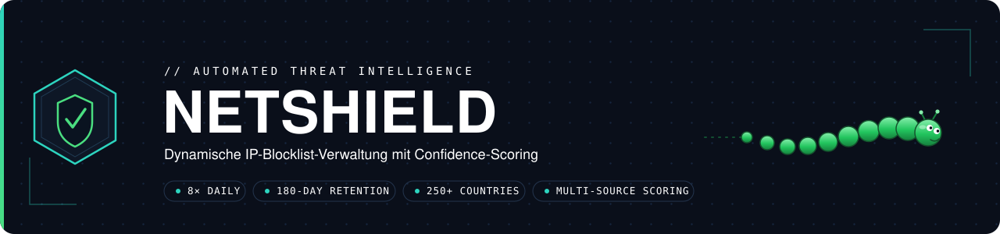

<div align="center">

<a id="netshield"></a>



<br>

[](https://github.com/juergen2025sys/NETSHIELD/actions/workflows/update_combined_blacklist.yml)
&nbsp;
[](https://github.com/juergen2025sys/NETSHIELD/actions/workflows/feed_health_monitor.yml)
&nbsp;
[](https://github.com/juergen2025sys/NETSHIELD/actions/workflows/update_confidence_blacklist.yml)
&nbsp;
[](https://github.com/juergen2025sys/NETSHIELD/actions/workflows/false_positive_checker.yml)

[**⚡ Quick Start**](#-quick-start--opnsense-alias) · [**📊 Blocklisten**](#-blocklisten) · [**🌐 ASN-Sperre**](#-asn-sperre-netzbetreiber) · [**🎯 Scoring**](#-wie-funktioniert-die-bewertung) · [**🏗️ Architektur**](#%EF%B8%8F-architektur) · [**⚙️ Workflows**](#%EF%B8%8F-workflows) · [**📡 Feeds**](#-feed-quellen)

</div>

---

## 📊 Key Statistics

<!-- STATS_TABLE_START -->
<table>
<tr>
<td align="center" valign="top" width="25%">
<h3>303</h3>
<sub>IP-Quellen<br>(dynamisch)</sub>
</td>
<td align="center" valign="top" width="25%">
<h3>334,512</h3>
<sub>Aktive IP-Drohungen<br>(Confidence ≥65)</sub>
</td>
<td align="center" valign="top" width="25%">
<h3>37,346</h3>
<sub>CVE/Exploit IPs<br>&nbsp;</sub>
</td>
<td align="center" valign="top" width="25%">
<h3>2,076,171</h3>
<sub>Honeypot IPs<br>&nbsp;</sub>
</td>
</tr>
</table>
<!-- STATS_TABLE_END -->

<!-- META_TABLE_START -->
<table>
<tr>
<td><strong>🕒 Letztes Update</strong></td>
<td>2026-11-28 10:59 CET (Europe/Berlin)</td>
<td><strong>🔄 Intervall</strong></td>
<td>8× täglich</td>
</tr>
<tr>
<td><strong>📅 IP-Retention</strong></td>
<td>180 Tage</td>
<td><strong>⚙️ Aktive Workflows</strong></td>
<td>36</td>
</tr>
<tr>
<td><strong>🌍 Abdeckung</strong></td>
<td colspan="3">250+ Länder</td>
</tr>
</table>
<!-- META_TABLE_END -->

> NETSHIELD aggregiert, bewertet und bereinigt mehrmals täglich IP-Bedrohungsdaten aus **rund 300 Quellen** (dynamisch, wächst laufend durch Auto-Discovery): öffentliche Remote-Feeds, große Sensor-Netze (z. B. DShield/SANS, NERD/CESNET), lokale Sub-Workflow-Feeds (CVE, Honeypot, Honigtopf, Proxy-Feeds, TweetFeed, Reputation) und per GitHub-Discovery entdeckte Feeds. Das System unterscheidet aktive Bedrohungen von veralteten statischen Listen und liefert daraus qualitativ hochwertige Blocklisten für OPNsense, pfSense und iptables.

---

## ⚡ Quick Start – OPNsense-Alias

1. **Firewall → Aliase → Hinzufügen**, Typ **URL-Tabelle (IPs)**, Aktualisierung z. B. alle 1–3 Stunden.
2. Eine der folgenden Listen als URL eintragen:

| Ziel | URL |
|---|---|
| 🛡️ Direktes Blocking (empfohlen) | `https://raw.githubusercontent.com/juergen2025sys/NETSHIELD/main/active_blacklist_ipv4.txt` |
| 📦 Alle IPs, Teil 1 + Teil 2 (zwei Aliase) | `…/combined_threat_blacklist_ipv4_part1.txt` · `…/combined_threat_blacklist_ipv4_part2.txt` |
| 🌐 Netzbetreiber-Sperre | `…/asn/asn_drop_ipv4.txt` |
| 🕵️ Offene Proxys (ausgehend) | `…/proxy/offene_proxies.txt` |

3. **Firewall → Regeln**: Block-Regel mit dem Alias als Quelle (WAN, eingehend) bzw. als Ziel (LAN, ausgehend). Freigabe-Regeln für eigene Ausnahmen **vor** die Block-Regeln setzen.

---


## 📋 Blocklisten

| Datei | Zweck | Einträge | Empfohlen für |
|---|---|---:|---|
| 🛡️ [`active_blacklist_ipv4.txt`](active_blacklist_ipv4.txt) | Aktive Bedrohungen · letzte 30 Tage · Score ≥ 65 | **334,512** | OPNsense / pfSense / Firewall |
| 🔶 [`_part1.txt`](blacklist_confidence40_ipv4_part1.txt) · [`_part2.txt`](blacklist_confidence40_ipv4_part2.txt) | Mittleres bis hohes Vertrauen · Score ≥ 40 · 2 Parts | **7,807,978** | Erweiterte Filterregeln |
| 📦 [`_part1.txt`](combined_threat_blacklist_ipv4_part1.txt) · [`_part2.txt`](combined_threat_blacklist_ipv4_part2.txt) | Alle IPs · 180 Tage · 2 Parts | **11,316,589** | Audit / SIEM |
| 👁️ [`watchlist_confidence25to39_ipv4.txt`](watchlist_confidence25to39_ipv4.txt) | Watchlist · Score 25–39 | **3,508,611** | Monitoring |
| 💣 [`cve_exploit_ips.txt`](cve_exploit_ips.txt) | CVE-Exploits & aktive C2-Server | **37,346** | IDS / IPS |
| 🍯 [`honeypot_ips.txt`](honeypot_ips.txt) | Honeypot-bestätigte Angreifer | **2,076,171** | Ergänzung |
| 🍯 [`honigtopf_ips.txt`](honigtopf_ips.txt) | Honigtopf Community Honeypot (API) | **22,976** | Ergänzung |
| 🐦 [`tweetfeed_ips.txt`](tweetfeed_ips.txt) | TweetFeed.live Community IOCs | **7,671** | Ergänzung |
| 🤖 [`bot_detector_blacklist_ipv4.txt`](bot_detector_blacklist_ipv4.txt) | Proxy-, VPN- & Tor-IPs (Proxy-Feeds) | **1,217,201** | Ausgehend sperren |
| 🔗 [`reputation_blacklist.txt`](reputation_blacklist.txt) | Reputation Top-IPs (API, Score ≥50) | **9,988** | Ergänzung |

**Zusatzlisten (eigene Workflows, unabhängig vom Scoring):**

| Datei | Zweck | Einträge | Empfohlen für |
|---|---|---:|---|
| 🌐 [`asn/asn_drop_ipv4.txt`](asn/asn_drop_ipv4.txt) · [`asn/asn_drop_ipv6.txt`](asn/asn_drop_ipv6.txt) | Netze krimineller und auffälliger Netzbetreiber (ASN-Sperre) | **~19.400 Netze** (~15 Mio. IPv4) · **~4.200 IPv6-Netze** | OPNsense URL-Tabelle · beide Richtungen |
| 🧾 [`asn/asn_drop_asns.txt`](asn/asn_drop_asns.txt) | Gesperrte ASNs mit Quelle und Grund (Kontrolle) | **~1.500 ASNs** | Nachschlagen bei Fehlsperren |
| 🕵️ [`proxy/offene_proxies.txt`](proxy/offene_proxies.txt) | Offene Proxy-Server aus 14 öffentlichen Proxy-Listen (nur IPs) | **~16.000** | Ausgehend sperren |

> [!NOTE]
> **Combined-Blacklist = 2 Parts:** Die vollständige Liste (~11,3 Mio. IPs) steht in `combined_threat_blacklist_ipv4_part1.txt` und `_part2.txt` – IP-sortiert, gleich groß aufgeteilt, derzeit **je ~77 MB** (GitHub erlaubt max. 100 MB pro Datei). Für Firewalls (z. B. OPNsense) **beide Parts** als eigene URL-Tabellen-Aliase einbinden. Die frühere Einzeldatei `combined_threat_blacklist_ipv4.txt` gibt es nicht mehr.

<details>
<summary><strong>🌍 Geo-Listen</strong></summary>

```
countries/              →  IPv4-Ranges pro Land, nach Kontinent sortiert
continents/             →  Zusammengefasste Ranges pro Kontinent
all_countries_ipv4.txt  →  Alle Länder in einer Datei
```

</details>

---

## 🌐 ASN-Sperre (Netzbetreiber)

Sperrt **ganze Netzbetreiber**, die kriminell sind oder bei denen auffällig viele Angreifer sitzen. Der Workflow **ASN-DROP** löst die ASNs über [ipverse/as-ip-blocks](https://github.com/ipverse/as-ip-blocks) in IP-Netze auf → `asn/asn_drop_ipv4.txt` / `asn_drop_ipv6.txt`.

- **Quellen:** Spamhaus ASN-DROP · BPH_Research · Maltrail worst_asns · Bulletproof Hosting Watch · eigene feste Liste · Dichte-Auswertung der Angreifer-Feeds · monatliches ASN-Risiko
- **Schutz vor Fehlsperren:** per Dichte nur Netzbetreiber mit ≤ 1 Mio. Adressen, ≥ 5 auffälligen IPs und ≥ 0,25 % Dichte; große Clouds und Provider (Cloudflare, Akamai, DigitalOcean …) nie. Dichte-Sperren enden 14 Tage nach dem letzten Auftauchen.
- **Nachvollziehbar:** `asn/asn_drop_asns.txt` nennt zu jedem ASN Quelle und Grund.

---

## 🎯 Wie funktioniert die Bewertung

Jede IP bekommt einen **Confidence-Score (0–100)** aus vier Dimensionen:

```
Score = Quellen-Qualität (40) + Aktualität (30) + Persistenz (20) + Bekannt seit (10)
```

| Dimension | **Gewicht** | Logik |
|---|:---:|---|
| 🏅 Quellen-Qualität | `40` | HQ-Feed = 40 · 5+ Feeds heute = 35 · 3+ heute = 28 · 2+ heute = 20 · 5+ gesamt = 15 · 3+ gesamt = 10 · 2+ gesamt = 5 |
| ⏱️ Aktualität | `30` | Heute = 30 · ≤ 3 Tage = 25 · ≤ 7 Tage = 20 · ≤ 14 Tage = 12 · ≤ 30 Tage = 6 |
| 🔁 Persistenz | `20` | 14+ Tage = 20 · 7 Tage = 15 · 3 Tage = 10 · 2 Tage = 6 · 1 Tag = 2 |
| 📆 Bekannt seit | `10` | 90+ Tage = 10 · 30+ Tage = 6 · 14+ Tage = 3 |

> [!IMPORTANT]
> Nur **HQ-Feeds** (Feodo, AbuseIPDB, Spamhaus, DataPlane, FireHOL u. a.) bestimmen die Lebenszeit einer IP. Statische Mega-Listen erhöhen den Score, können eine IP aber nicht am Leben halten. Nach **180 Tagen** ohne HQ-Bestätigung wird eine IP automatisch entfernt (Active-Pfad). Watchlist-IPs ohne HQ-Bestätigung laufen bereits nach **30 Tagen** ab.
>
> **Anti-Churn-Ledger:** Läuft eine IP ab, wird ihr Ablauf-Datum in `state/watchlist_expired_history.json` bzw. `state/active_expired_history.json` eingefroren, bevor sie aus `seen_db` verschwindet. Meldet danach nur ein **schwacher/derselbe** Feed sie erneut, bekommt sie ihr eingefrorenes Datum zurück statt eines frischen – sie bleibt dauerhaft draußen, kein Zurückkommen mit zurückgesetzter Uhr. Beide Ledger liegen als gemeinsames GitHub-Release-Asset (`anti-churn-ledger-backup`), nicht im Git-Verlauf – kein Repo-Wachstum, egal wie groß sie werden. Eine echte Neubestätigung setzt die Sperre außer Kraft, aber die Schwelle dafür ist **asymmetrisch**:
> - **Watchlist-Pfad (30T):** Eine **brandneue** IP (nie im Ledger) kommt mit 2+ Feeds oder 1 HQ-Feed rein wie gewohnt. Eine **bereits eingefrorene** IP braucht für den Wiedereintritt dagegen **5 beliebige Feeds am selben Tag** (nicht zwingend HQ) – deutlich strenger als früher (1 HQ-Feed reichte), um zu verhindern, dass eine einzelne, evtl. unzuverlässige Quelle eine bereits als schwach eingestufte IP immer wieder "vergibt".
> - **Active-Pfad (180T):** Es braucht **2+ verschiedene HQ-Feed-Familien am selben Tag** (Zweitbestätigung). Ein einzelner HQ-Feed reicht hier bewusst **nicht** – sonst würde genau der ursprüngliche Fehler (IP bekommt bei jedem erneuten Auftauchen sofort wieder volle 180 Tage) zurückkehren.
> - Wird eine eingefrorene IP legitim neu bestätigt, räumt ein **rückwirkender Sweep** bei jedem Lauf automatisch ihren veralteten Ledger-Eintrag ab – auch wenn die Beförderung schon vor Tagen/Wochen passierte und die IP seither von keinem Feed mehr aktiv gemeldet wurde.
> - Watchlist-Einträge werden nach **14 Tagen** seit tatsächlicher Einfrierung automatisch aufgeräumt (Active: 180 Tage Puffer), damit der Ledger nicht unbegrenzt wächst. Ein **Sanity-Guard** blockiert automatisch jedes Pruning, das mehr als die Hälfte eines mindestens 1.000 Einträge großen Ledgers auf einen Schlag entfernen würde (löst stattdessen einen GitHub-Issue-Alarm aus) – Schutz gegen genau die Fehlerklasse, die den Ledger einmal versehentlich von 657.370 auf 0 Einträge einbrechen ließ.
>
> **Aufnahme-Warteliste (Kreuzbestätigung über mehrere Tage):** Eine IP mit nur 1 (nicht-HQ) Feed schafft die reguläre Aufnahmeschwelle (2+ Feeds oder 1 HQ-Feed) nicht und würde sofort wieder verworfen. Statt sie zu vergessen, merkt sich das System sie für **7 Tage** – meldet in diesem Fenster ein zweiter, unabhängiger Feed dieselbe IP, gilt das als echte Kreuzbestätigung und sie wird doch aufgenommen (Watchlist-Pfad). Liegt als eigenes GitHub-Release-Asset (`aufnahme-warteliste-backup`), nicht im Git-Verlauf.
>
> Details und Hintergrund: reports/ip_ablauf_verifikation_report.md.

### Score-Schwellen

| Score | Liste | Verwendung |
|:---:|---|---|
| 🔴 **≥ 65** | `active_blacklist` | Firewall · direktes Blocking |
| 🟠 **≥ 40** | `confidence40` | Erweiterte Regeln |
| 🟡 **25–39** | `watchlist` | Nur Monitoring |
| ⚪ **< 25** | `combined` | Audit / SIEM |

---

## 🏗️ Architektur

```
~300 Quellen · dynamisch (Remote + Lokal + Auto-Discovered)
        │
        ▼
┌─────────────────────────────────────────────┐
│         Update Combined Blacklist           │  ← Haupt-Engine · 8× täglich
│                                             │
│  ┌─────────────┐  ┌──────────────────────┐  │
│  │  seen_db    │  │ False-Positive-Set   │  │
│  │  (Cache)    │  │ (Whitelist-Filter)   │  │
│  └──────┬──────┘  └──────────────────────┘  │
│         │                                   │
│   Score-Berechnung · HQ/Non-HQ Trennung     │
│   IP-Lebenszeit: 180T (HQ) / 30T (Watchlist)│
│   + Anti-Churn-Ledger (kein Reset-Flackern) │
└──────────┬──────────────────────────────────┘
           │
     ┌─────┼─────────────────┐
     ▼     ▼                 ▼
  active  combined      confidence40
  ≥65     180T          ≥40 / watchlist
    │       │                │
    ▼       ▼                ▼
 OPNsense  Audit/SIEM    Analyse

Sub-Workflows (vor Combined):
  CVE Mapper ──────┐
  Honeypot Monitor ├──→ Lokale .txt-Dateien ──→ Combined liest ein
  Honigtopf        │
  Proxy-Feeds ─────┘

Enrichment (nach Combined):
  Score Decay ─────→ Alterungs-Report (read-only)
```

---

## ⚙️ Workflows

<details open>
<summary><strong>🔧 Kern-Pipeline</strong></summary>

| Workflow | Zeitplan | Aufgabe |
|---|---|---|
| **Update Combined Blacklist** | 8× täglich, alle 3h (00:07, 03:07 … 21:07 UTC; +Backups :27/:47) | Feeds laden, seen_db aktualisieren, combined + active Blacklists schreiben |
| **Confidence Blacklist** | 8× täglich (01:47, 04:47 … 22:47 UTC) | confidence40 + watchlist aus seen_db berechnen |
| **False Positive Checker** | 3× täglich (05:00, 13:00, 20:00 UTC) | Whitelist-CIDRs prüfen → false_positives_set.json |
| **NETSHIELD Report Generator** | stündlich :30 (+Backups :45/:55, Gate prüft auf bereits erfolgreichen Lauf) | NETSHIELD_REPORT.md + README-Statistiken aktualisieren |

</details>

<details>
<summary><strong>📡 Datenquellen (Sub-Workflows)</strong></summary>

| Workflow | Zeitplan | Aufgabe |
|---|---|---|
| **CVE-to-IP Mapper** | täglich 04:00 | C2/Exploit-IPs → cve_exploit_ips.txt |
| **Honeypot Monitor** | 4× täglich (05:00, 11:00, 17:00, 23:00) | Honeypot-Feeds → honeypot_ips.txt |
| **Honigtopf** | alle 2h (:17) + stündlich über den Report Generator | Honigtopf API → honigtopf_ips.txt |
| **TweetFeed Monitor** | täglich 02:45 | TweetFeed.live IOCs → tweetfeed_ips.txt |
| **Bot-Detector Blacklist (Proxy-Feeds)** | täglich 22:35 | Proxy-, VPN- und Tor-Feeds → bot_detector_blacklist_ipv4.txt |
| **DNS List Mirror** | alle 2h (:35) + über den Report Generator | ThreatFox-, stamparm-, ET-Open- und FRITZ!Box-Domainlisten → dns/ |
| **DNS Blocklist Finder** | täglich 04:40 | Sucht neue DNS-Sperrlisten |
| **ASN-DROP** | täglich 04:15 + 06:15 (+ manuell) | Netzbetreiber-Sperre → asn/asn_drop_ipv4.txt, asn_drop_ipv6.txt, asn_drop_asns.txt |
| **Offene Proxies** | alle 2h (:40) + stündlich über den Report Generator | 14 Proxy-Listen → proxy/offene_proxies.txt |
| **Auto Feed Discovery** | wöchentlich So 04:37 (+Backups 07:23, 11:47) | GitHub nach neuen Feeds durchsuchen |
| **Auto-Feed Live Refresh** | täglich 02:15 | Aktuelle Inhalte aller auto-entdeckten Feeds als SQLite-Snapshot bauen (Combined liest ihn identitätserhaltend ein) |

</details>

<details>
<summary><strong>🔍 Enrichment & Monitoring</strong></summary>

| Workflow | Zeitplan | Aufgabe |
|---|---|---|
| **Score Decay Monitor** | wöchentlich So 07:00 | Alterungs-Report (read-only) |
| **Feed Overlap Report** | wöchentlich So 03:25 | Analysiert Redundanz zwischen Feeds (welche Quellen liefern dieselben IPs) |
| **Feed Health Monitor** | täglich 01:00 | Feed-URLs auf Erreichbarkeit prüfen |
| **IP-Ablauf – Prognose** | wöchentlich Mo 06:30 | seen_db-Cluster-Vorschau + tiefe Ledger-Konsistenzprüfung → `reports/ip_ablauf.md` |
| **IP-Ablauf – Verifikation** | alle 3h (Slot :55) | Prüft Anti-Churn-Ledger gegen alle Output-Dateien, Staleness-/Trend-Diagnose, GitHub-Issue-Alarm bei Rückfall → `reports/ip_ablauf_verifikation_report.md` (+ `.zip`) |
| **Watchdog IP-Ablauf** | alle 30 min | Prognose- und Verifikation-Job auf verpasste Cron-Slots überwachen |
| **Workflow Health Checker** | 4× täglich (01:15, 07:15, 13:15, 19:15) | Python-Code + Production Health Checks (seen_db, Output-Sanity, Drift, Feed-Ausfälle) |
| **Workflow Health Dashboard** | alle 6h (00:05, 06:05, 12:05, 18:05) | Workflow-Status-Report schreiben |
| **Ubuntu Runner Watch** | wöchentlich So 02:00 | Prüft neue GitHub-Runner-Images |
| **Watchdog Combined** | alle 15 min | Combined-Pipeline und weitere Ziel-Workflows (u. a. Honigtopf) auf Stillstand überwachen |
| **CodeQL Security Scan** | wöchentlich So 03:00 | Statische Sicherheitsanalyse des Codes |
| **Update All Countries IPv4** | Mo + Mi 01:30 | Länder/Kontinente IPv4-Ranges synchronisieren |

</details>

<details>
<summary><strong>🛠️ Wartung, Tests & Supply-Chain-Sicherheit</strong></summary>

| Workflow | Zeitplan | Aufgabe |
|---|---|---|
| **Run Tests** | bei Push/PR auf `scripts/`, `tests/`, `.github/workflows/` | rund 500 Python-Unit-Tests |
| **Dependabot Auto-Merge** | bei Dependabot-PR | Patch/Minor automatisch mergen (2 Tage Cooldown gegen getarnte Kompromittierungen), Major bleibt manuell |
| **Dependabot Heal Conflicts** | täglich 04:17 UTC + manuell | Löst Merge-Konflikte in offenen Dependabot-PRs automatisch auf |
| **Ledger Diagnose** | manuell | Tiefe Konsistenzprüfung der Anti-Churn-Ledger (Watchlist/Active) |
| **History Fresh Start** | monatlich (1. Tag, 05:20) + manuell | Setzt die Git-Historie zurück (Repo-Größenschutz), Dateiinhalt bleibt erhalten |
| **Repo Größe prüfen** | manuell | Repo-Größe und größte Dateien auflisten |
| **Feed IP Finder** | manuell | Prüft, in welchen Feeds eine bestimmte IP aktuell vorkommt |
| **Force Cancel Stuck Runs** | manuell | Hängende Workflow-Läufe gezielt abbrechen |
| **SniffCat Fetch** | manuell | Zusätzliche IPs aus der SniffCat-API laden (Artefakt, kein automatischer Feed) |
| **WireGuard Test** | manuell | Testlauf |

</details>

---

## 🕐 Datenfluss & Timing

```
── Häufig / stündlich (UTC) ───────────────────────────────────
*/15              Watchdog Combined            (Stillstands-Check)
*/30              Watchdog IP-Ablauf           (Stillstands-Check)
:17 (alle 2h)     Honigtopf  ──────────────────┐  (+ stündlich über Report)
:30               NETSHIELD Report Generator   │  (stündlich)
:55 (alle 3h)     IP-Ablauf – Verifikation     │  (8× täglich)
                                               │
── Combined-Pipeline · 8× täglich, alle 3h ────┤
00:07,03:07 … 21:07  Update Combined Blacklist ┼──→ seen_db Cache
                     (+Backups :27 / :47)      │
01:47,04:47 … 22:47  Confidence Blacklist ─────┘  (8× täglich)

── Täglich · feste Slots (UTC) ────────────────────────────────
00:05,06:05,12:05,18:05  Workflow Health Dashboard
01:00             Feed Health Monitor
01:15,07:15,13:15,19:15  Workflow Health Checker
01:30 (Mo+Mi)     Update All Countries
02:45             TweetFeed Monitor
03:00 (So)        CodeQL Security Scan
04:00             CVE-to-IP Mapper
04:15,06:15       ASN-DROP (Netzbetreiber-Sperre)
:35 (alle 2h)     DNS List Mirror
:40 (alle 2h)     Offene Proxies (+ stündlich über Report Generator)
02:00 (So)        Ubuntu Runner Watch
04:40             DNS Blocklist Finder
04:37 (So)        Auto Feed Discovery (+Backups 07:23, 11:47)
05:00,11:00,17:00,23:00  Honeypot Monitor
05:00,13:00,20:00        False Positive Checker
06:30 (Mo)        IP-Ablauf – Prognose
07:00 (So)        Score Decay Monitor
22:35             Bot-Detector Blacklist (Proxy-Feeds)
```

---

## 📈 Reports & Monitoring

| Datei | Inhalt |
|---|---|
| 📊 [`NETSHIELD_REPORT.md`](reports/NETSHIELD_REPORT.md) | Gesamtübersicht + Feed Health (stündlich) |
| 💚 [`feed_health_report.md`](reports/feed_health_report.md) | Status aller Feed-URLs |
| ⚙️ [`workflow_health_report.md`](reports/workflow_health_report.md) | Workflow-Analyse (Python-Syntax, Cron-Timing, Guards) |
| 🔀 [`combined_threat_blacklist_report.md`](reports/combined_threat_blacklist_report.md) | Feed-Statistik pro Lauf |
| 📉 [`score_decay_report.md`](reports/score_decay_report.md) | Alterungs-Analyse der seen_db |
| 🔮 [`ip_ablauf.md`](reports/ip_ablauf.md) | Ablauf-Prognose (Cluster-Vorschau nächste 30/60 Tage, wöchentlich) |
| ✅ [`ip_ablauf_verifikation_report.md`](reports/ip_ablauf_verifikation_report.md) | Anti-Churn-Ledger-Kontrolle: Rückfälle, seen_db-Trend, Erfolgsquote (alle 3h, + `.zip`-Bundle) |
| 🔎 [`auto_feed_discovery_report.md`](reports/auto_feed_discovery_report.md) | Neu entdeckte Feeds + Bewertung |

---

## 📡 Feed-Quellen

NETSHIELD bezieht Daten aus folgenden Kategorien:

| Kategorie | Beispiele | HQ |
|---|---|:---:|
| Abuse-Tracker | Feodo, ThreatFox, URLhaus (abuse.ch) | ✅ |
| Blocklist-Aggregatoren | FireHOL Level 1–4, blocklist.de | ✅ |
| Sensor-Netze | DShield/SANS (Tagesquellen ab 10 Sensoren, Webscanner), NERD/CESNET | ❌ |
| Honeypot-Netzwerke | DataPlane, Turris Sentinel, Honigtopf (API) | ✅ |
| Reputation-Feeds | AbuseIPDB (API + Mirrors), ipsum, CINSscore | ✅ |
| C2/Botnet-Tracker | C2-Tracker, MISP C2 Intel Feeds | ✅ |
| Threat Intelligence | Spamhaus DROP, Emerging Threats, Threatview | ✅ |
| Community-Feeds | GitHub-Repos (auto-discovered) | ❌ |
| Proxy/VPN/Tor | 14 offene Proxy-Listen, VPN- und Tor-Feeds | ❌ |
| Brute-Force-Listen | CrowdSec, danger.rulez.sk, blocklist.de/ssh | ✅ |

> [!IMPORTANT]
> **HQ-Feeds** (rund die Hälfte aller Remote-Quellen) bestimmen die Lebenszeit einer IP. Non-HQ-Feeds erhöhen den Confidence-Score, können IPs aber nicht am Leben halten.

---

## 📁 Dateistruktur

<details>
<summary><strong>Repository-Layout anzeigen</strong></summary>

```
NETSHIELD/
├── .github/workflows/                   # GitHub Actions Workflows
├── continents/                          # IPv4-Ranges pro Kontinent
├── countries/                           # IPv4-Ranges pro Land
│   ├── africa/ · asia/ · europe/
│   ├── north_america/ · oceania/ · south_america/
│
├── active_blacklist_ipv4.txt            # → Firewall (Score ≥65, 30 Tage)
├── blacklist_confidence40_ipv4_part1.txt  # → Erweiterte Regeln (Score ≥40) – kanonisch, Teil 1/2
├── blacklist_confidence40_ipv4_part2.txt  #   kanonisch, Teil 2/2 (Einzeldatei nicht mehr committet)
├── combined_threat_blacklist_ipv4_part1.txt  # → Audit / SIEM (180 Tage) – kanonisch, Teil 1/2
├── combined_threat_blacklist_ipv4_part2.txt  #   kanonisch, Teil 2/2 (Einzeldatei nicht mehr committet)
├── watchlist_confidence25to39_ipv4.txt  # → Monitoring (Score 25–39)
│
├── cve_exploit_ips.txt                  # CVE/C2-IPs (täglich)
├── honeypot_ips.txt                     # Honeypot-Feeds (täglich)
├── honigtopf_ips.txt                    # Honigtopf API (alle 2h)
├── tweetfeed_ips.txt                    # TweetFeed.live IOCs (täglich)
├── bot_detector_blacklist_ipv4.txt      # Proxy-, VPN- & Tor-Feeds (täglich)
├── reputation_blacklist.txt             # Reputation API (Round-Robin)
│
├── asn/
│   ├── asn_drop_ipv4.txt                # → Firewall: Netze gesperrter Netzbetreiber
│   ├── asn_drop_ipv6.txt                #   IPv6-Gegenstück
│   ├── asn_drop_asns.txt                #   ASNs mit Quelle/Grund (Kontrolle)
│   ├── asn_dichte_haltezeit.json        #   14-Tage-Haltezeit der Dichte-Netze
│   ├── asn_risiko.txt                   #   monatliche ASN-Risiko-Bewertung (nur Nummern)
│   └── threatfox_asn_kandidaten.txt     #   alle Dichte-Kandidaten mit Werten
│
├── proxy/
│   └── offene_proxies.txt               # → Firewall: offene Proxy-Server
│
├── dns/                                 # Domain-Listen für DNS-Filter (Unbound, FRITZ!Box)
│   ├── threatfox_domains.txt · stamparm_malicious_domains.txt · et_open_domains.txt
│   ├── fritzbox_domains.txt             #   ThreatFox + ET Open für die FRITZ!Box
│   └── threatfox_c2_ips.txt · stamparm_c2_ips.txt
│
├── state/
│   ├── auto_discovered_feeds.json       # Auto-entdeckte Feeds
│   ├── false_positives_set.json         # FP-Whitelist
│   ├── feed_health_status.json          # Feed-Status
│   └── seen_db_meta.json                # seen_db Metadaten (DB im Cache)
│   (Anti-Churn-Ledger und Aufnahme-Warteliste liegen als GitHub-Release-Assets
│    "anti-churn-ledger-backup" / "aufnahme-warteliste-backup", nicht im Repo)
│
├── reports/
│   ├── NETSHIELD_REPORT.md              # Haupt-Dashboard
│   ├── combined_threat_blacklist_report.md · feed_health_report.md
│   ├── workflow_health_report.md · score_decay_report.md · auto_feed_discovery_report.md
│   ├── ip_ablauf.md                     # Ablauf-Prognose (wöchentlich)
│   ├── ip_ablauf_verifikation_report.md # Anti-Churn-Kontrolle (alle 3h)
│   └── ip_ablauf_verifikation_report.zip  # Download-Bundle (selbstaktualisierend)
│
├── scripts/                             # Gemeinsamer Python-Code (netshield_common.py u. a.)
├── tests/                               # Unit-Tests
└── README.md
```

</details>

---

## 🔒 Schutzmechanismen

| Mechanismus | Beschreibung |
|---|---|
| 🛑 **Leerungsschutz** | Jeder Workflow prüft MIN_ENTRIES vor dem Schreiben — bei zu wenigen Ergebnissen bleibt die alte Datei erhalten |
| ⚪ **False-Positive-Filter** | Umfangreiche Whitelist (CDN, DNS, Mail, Cloud-Provider) verhindert Blocking legitimer Infrastruktur |
| 🏅 **HQ/Non-HQ-Trennung** | Nur verifizierte HQ-Feeds verlängern die Lebenszeit einer IP — statische Listen können IPs nicht am Leben halten |
| 🧊 **Anti-Churn-Ledger** | Abgelaufene IPs bekommen bei schwacher Wiedersichtung ihr eingefrorenes Ablauf-Datum zurück statt eines frischen — kein endloses Reset-Flackern mehr |
| 📥 **Aufnahme-Warteliste** | IPs mit nur 1 Feed haben 7 Tage Zeit auf eine Kreuzbestätigung durch einen zweiten, unabhängigen Feed, statt sofort verworfen zu werden |
| 🛑 **Ledger-Sanity-Guard** | Blockiert automatisch jedes Pruning, das mehr als die Hälfte eines Ledgers (≥1.000 Einträge) auf einen Schlag entfernen würde – löst statt der Löschung einen GitHub-Issue-Alarm aus |
| 🌐 **ASN-Schutz** | ASN-DROP behält die alte Liste bei < 100 Spamhaus-ASNs, > 10 % fehlgeschlagenen Präfix-Abrufen oder < 1.000 Netzen; ausgefallene Zusatzquellen erzeugen nur eine Warnung; nur öffentliche (is_global) Präfixe |
| 🔁 **Push-Retry** | 5 Versuche mit git rebase bei gleichzeitigen Commits |
| 🔐 **Concurrency-Lock** | Jeder Workflow läuft max. 1× gleichzeitig |
| 📦 **Cache-Isolation** | Eigene Cache-Familien pro Zweck (`seen-db-sqlite-v1`, `seen-db-v2` als JSON-Kompat-Cache, `auto-feed-daily-v1`, `watchlist-cap-state-v1` u. a.) – kein gegenseitiges Überschreiben zwischen Workflows; alte Einträge der größten Familie (~500 MB) werden nach jedem Lauf automatisch aufgeräumt (behält die 2 neuesten) |

---

<div align="center">

<sub>*Automatisch aktualisiert · [NETSHIELD_REPORT.md](reports/NETSHIELD_REPORT.md)*</sub>

<sub>[⬆ Nach oben](#netshield)</sub>

</div>
